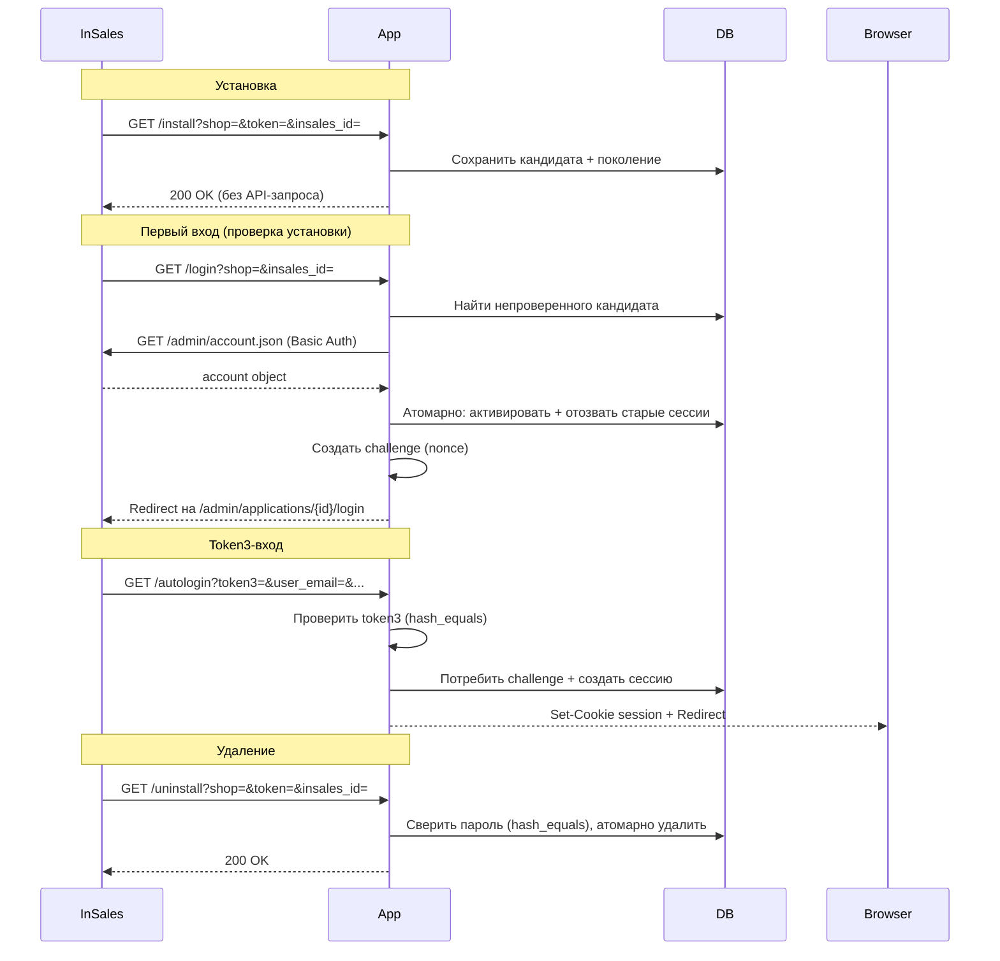

# InSales Partner App (PHP)

Заготовка устанавливаемого партнёрского приложения InSales на PHP 8.4+.
Принимает установку магазина, вход сотрудника по token3 и удаление.

**Стек:** Slim 4, Guzzle, PDO/SQLite, PHP-DI.
**Протокол:** install, autologin, uninstall.

> **Статус:** заготовка для разработки. Не является production-ready решением без
> аудита безопасности, замены SQLite на промышленную БД и настройки HTTPS.

---

## Быстрый старт

### Требования

- PHP 8.4+
- Расширения: `ext-pdo`, `ext-pdo_sqlite`, `ext-sodium`, `ext-mbstring`, `ext-curl`
- Для тестов дополнительно `ext-sockets`: симулятор занимает свободный порт через `socket_create`
- Composer 2

### Установка

```bash
git clone <url-репозитория> insales_app_php
cd insales_app_php
cp .env.example .env
```

Отредактируйте `.env`:

| Переменная | Описание |
|---|---|
| `INSALES_APP_ID` | Идентификатор приложения из кабинета InSales |
| `INSALES_APP_SECRET` | Секрет приложения из кабинета InSales |
| `APP_BASE_URL` | Публичный URL приложения (например, `https://myapp.example` или `http://127.0.0.1:8765`) |
| `ALLOWED_SHOPS` | Список разрешённых доменов магазинов через запятую |
| `APP_ENCRYPTION_KEY` | 64-символьный hex-ключ (32 байта). **Обязателен в production.** Сгенерируйте: `php -r 'echo bin2hex(sodium_crypto_secretbox_keygen());'` |
| `APP_DB_PATH` | Путь к SQLite. Относительный путь считается от корня проекта и в CLI, и в HTTP, в том числе когда `php -S` запущен с каталогом `public` |

Установите зависимости, выполните миграции и запустите приложение:

```bash
composer install
php bin/app.php db upgrade
php -S 127.0.0.1:8765 -t public
```

### Проверка здоровья

```bash
curl http://127.0.0.1:8765/health
# → ok
```

### Диагностика

```bash
php bin/app.php doctor
php bin/app.php doctor --check-api   # С HTTP-запросами к магазинам
```

---

## Настройка приложения в бэк-офисе

1. Откройте раздел «Разработчикам» и нажмите «Добавить расширение».
2. Заполните:

   | Поле | Значение |
   |---|---|
   | Название | Ваше приложение |
   | Идентификатор | Например, `my_app`. Это логин HTTP Basic, одинаковый для всех магазинов |
   | URL установки | `https://myapp.example/install` |
   | URL входа | `https://myapp.example/login` |
   | URL деинсталяции | `https://myapp.example/uninstall` |

3. Сохраните расширение. Секрет формируется при создании; скопируйте идентификатор и секрет в `.env`.
4. Выдайте права только на нужные ресурсы. Для запроса `/admin/account.json` нужно чтение настроек магазина.

---

## Жизненный цикл приложения



### Установка (`GET /install`)

InSales вызывает callback. Приложение **не обращается к API** на этом этапе:
- Проверяет параметры и пароль `MD5(token + app_secret)`
- Сохраняет непроверенный кандидат в транзакции (до 5 свежих кандидатов на домен магазина)
- Отвечает `200` в пределах 10 секунд

Повтор того же пароля до активации возвращает `200` и не создаёт второго кандидата. Повтор после активации тоже возвращает `200` и не меняет поколение. Другой пароль сохраняется отдельным кандидатом; действующее подключение меняется только после проверки API. Непроверенный кандидат старше 24 часов снимается при следующем `/install`, поэтому квота освобождается без ручной очистки.

### Первый вход и проверка (`GET /login`)

Перед созданием nonce приложение:
1. Находит самый новый непроверенный кандидат для данного магазина
2. Выполняет **один** `GET /admin/account.json` с credentials кандидата (без retry)
3. При успехе — атомарно активирует подключение, отзывает старые сессии
4. При временной ошибке — сохраняет кандидат; страница входа показывает `503`
5. При неверных credentials — отклоняет только этот кандидат

Если кандидатов нет, а активное подключение есть — вход проходит без API-запроса.

### Token3 и сессия (`GET /autologin`, `POST /logout`)

Формула `token3 = MD5(nonce + user_email + user_name + user_id + email_confirmed + password)`.
Поля конкатенируются без разделителя, UTF-8. `email_confirmed` — строка `"true"` или `"false"`.

- Challenge одноразовый, привязан к браузеру, магазину, поколению установки и TTL (5 мин)
- Cookie challenge (`insales_app_challenge`) отделена от cookie сессии (`insales_app_session`)
- `POST /logout` отзывает только текущую сессию

### Удаление (`GET /uninstall`)

InSales вызывает callback. Параметр `token` — **пароль магазина** (не install token, не secret).
Сравнение через `hash_equals` в одной транзакции:
- Удаляются активная установка и все кандидаты с этим паролем, их сессии, challenge и поколения
- Кандидаты с другим паролем остаются
- Повтор того же пароля, когда этой установки уже нет, — идемпотентный `200`. Для этого хранится только keyed-хеш пароля, не дольше 30 дней и не больше пяти значений на магазин
- Старый пароль после переустановки получает `401` и не снимает новое поколение

---

## CLI

```bash
php bin/app.php db upgrade        # Применить миграции
php bin/app.php db status         # Показать версию схемы
php bin/app.php doctor            # Диагностика (конфиг, БД, расширения)
php bin/app.php doctor --check-api # + API-проверка активных магазинов
```

Миграции применяются явно перед запуском HTTP. Обычные HTTP-запросы не запускают DDL.

---

## Команды разработки

```bash
composer test              # Все тесты (69+ сценариев)
composer test:unit         # Только unit-тесты
composer test:integration  # Только integration-тесты
composer analyse           # PHPStan (максимальный уровень)
composer lint              # PHPCS (PSR-12)
composer lint:fix          # Автоисправление стиля
composer audit             # Composer audit зависимостей
composer check             # Линтинг + анализ + тесты (полная проверка)
```

### Структура проекта

```
public/                     # HTTP entry point (index.php)
bin/
  app.php                   # CLI: миграции и диагностика
src/
  InSales/                  # Протокольный слой (не зависит от фреймворка)
    Protocol.php            #   MD5-формулы (installPassword, token3)
    ApiClient.php           #   HTTP-клиент к API InSales (без retry)
    ApiException.php        #   Ошибки API
    ShopValidator.php       #   Валидация доменов магазинов (+SSRF)
    NullLogger.php          #   Заглушка логгера
  Application/              # Сценарии жизненного цикла
    InstallationService.php #   Установка и активация кандидата при входе
    LoginService.php        #   Вход / autologin / сессии
    UninstallService.php    #   Удаление по паролю
    LoginException.php      #   Ошибки входа
  Http/                     # Slim-слой
    Controllers/            #   Install, Login, Uninstall, Dashboard
    Middleware/              #   SessionMiddleware
  Infrastructure/           # Инфраструктура
    Database.php            #   PDO/SQLite с миграциями и транзакциями
    Encryption.php          #   Sodium secretbox (XSalsa20-Poly1305)
    Config.php              #   Загрузка конфигурации
    ContainerFactory.php    #   DI-контейнер (PHP-DI)
    SlimAppFactory.php      #   Slim-приложение с маршрутами
migrations/                 # SQL-миграции (001–007)
tests/
  Unit/                     # Unit-тесты (Protocol, Encryption, ShopValidator)
  Integration/              # Интеграционные тесты (HTTP-симулятор)
  Simulator/                # Симулятор платформы InSales
  bootstrap.php             # Загрузчик тестов с явными миграциями
```

---

## Тестирование

Обычный запуск `composer test` не требует внешнего магазина. Нужен `ext-sockets`.

Два разных уровня:

- `ApplicationTest` проходит через Slim-фабрику: HTTP `/install`, `/login`, `/uninstall` и обработчики ошибок. Фабрика не подставляет URL симулятора, поэтому успешный вход с вызовом API магазина проверяет `LifecycleTest`.
- `LifecycleTest` создаёт сервисы напрямую и передаёт им loopback-URL симулятора. Так проверяются token3, изоляция магазинов, nonce, отзыв сессии, лимит кандидатов и uninstall. Маршрут браузера через фабрику и одновременная работа двух процессов в этот набор не входят. Базовый режим приложения — один web-процесс и одна SQLite.

---

## Различия development / production

| Аспект | Development | Production |
|---|---|---|
| HTTP | Разрешён для loopback | Только HTTPS |
| SQLite | Подходит для разработки | Заменить на PostgreSQL/MySQL |
| Миграции | Явные, через CLI | Явные, через CLI |
| Ключ шифрования | Может отсутствовать (предупреждение) | **Обязателен** |
| Сессии | SQLite | Redis / БД |
| Логирование | `NullLogger` | Для сопровождения подойдёт любой PSR-3, например Monolog |

---

## Ограничения

- Первый вход задерживается на время одного API-запроса к магазину
- Нет автоматической проверки неоткрытых установок (требуется действие пользователя)
- Базовый режим: один web-процесс и одна SQLite. Не проверен с пулом PHP-FPM
- Нет webhook-подсистемы, фоновых задач, worker, cron и очереди
- Нет OAuth/OIDC входа покупателей
- Встроенный PHP-сервер — только для разработки

---

## Лицензия

MIT

### Восстановление установки и вкладки браузера

При заполнении очереди приложение проверяет уже сохранённых кандидатов через API
в пределах двух секунд. Место освобождается только после `401`/`403` или
подтверждённого несовпадения `account.id`. Подтверждённые credentials и кандидаты
с временной ошибкой сохраняются; если места нет, callback отвечает `503` для
повторной доставки. Сетевые запросы выполняются вне транзакции записи.

SQLite хранит общий бюджет проверок домена: до 10 обращений за минуту и одно
одновременное обращение с арендой на 15 секунд. Временная ошибка откладывает
следующую проверку минимум на 5 секунд; `Retry-After` может увеличить паузу.
Перезапуск приложения сохраняет бюджет и кандидатов. Некорректный ответ `200`
считается временной ошибкой, а не основанием удалить credentials.

Проверенный `account.id` позволяет сохранить подключение после смены домена.
Активация нового владельца домена отзывает сессии прежнего подключения.
Challenge каждого входа выбирается параметром `flow` и остаётся связанным с
браузером: два начатых входа могут завершаться независимо.
В одном профиле браузера активен один магазин. Страницы и формы передают
ожидаемый `store_id`; после переключения магазина старая вкладка получает `409`.
Этот параметр проверяет контекст и не даёт доступа к чужому магазину.
