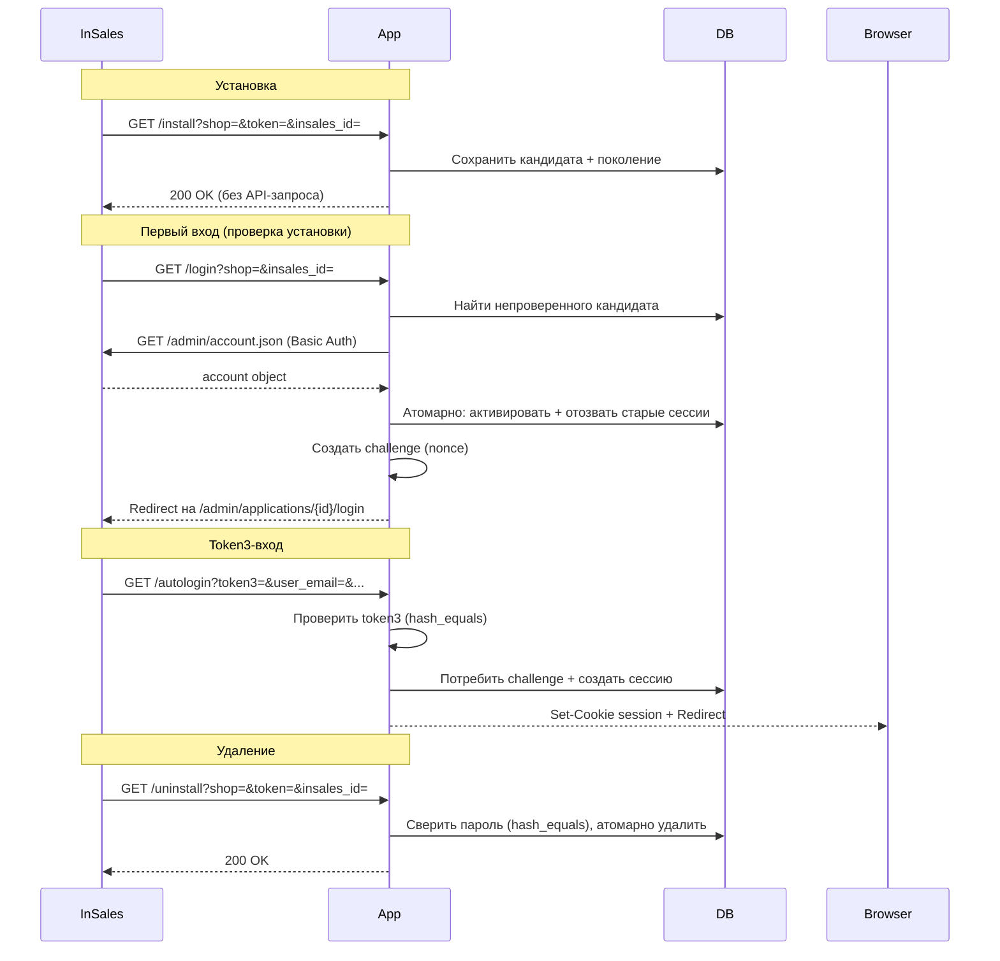

# InSales Partner App (PHP)

Заготовка устанавливаемого партнёрского приложения InSales на PHP 8.4+.

**Архитектура:** Slim 4 + Guzzle + PDO/SQLite + PHP-DI.
**Протокол:** классический install / autologin / uninstall.
**Проверка установки:** синхронно при первом входе сотрудника; отдельный worker и очередь не требуются.

> **Статус:** заготовка для разработки. Не является production-ready решением без
> аудита безопасности, замены SQLite на промышленную БД и настройки HTTPS.

---

## Быстрый старт

### Требования

- PHP 8.4+
- Расширения: `ext-pdo`, `ext-pdo_sqlite`, `ext-sodium`, `ext-mbstring`, `ext-curl`
- Composer 2

### Установка

```bash
git clone <url-репозитория> insales_app_php
cd insales_app_php
cp .env.example .env
```

Отредактируйте `.env`:

| Переменная | Описание |
|---|---|
| `INSALES_APP_ID` | Идентификатор приложения из кабинета InSales |
| `INSALES_APP_SECRET` | Секрет приложения из кабинета InSales |
| `APP_BASE_URL` | Публичный URL приложения (например, `https://myapp.example` или `http://127.0.0.1:8765`) |
| `ALLOWED_SHOPS` | Список разрешённых доменов магазинов через запятую |
| `APP_ENCRYPTION_KEY` | 64-символьный hex-ключ (32 байта). **Обязателен в production.** Сгенерируйте: `php -r 'echo bin2hex(sodium_crypto_secretbox_keygen());'` |
| `APP_DB_PATH` | Путь к SQLite-файлу (по умолчанию `runtime/app.sqlite3`, относительно корня проекта) |

Установите зависимости, выполните миграции и запустите приложение:

```bash
composer install
php bin/app.php db upgrade
php -S 127.0.0.1:8765 -t public
```

### Проверка здоровья

```bash
curl http://127.0.0.1:8765/health
# → ok
```

### Диагностика

```bash
php bin/app.php doctor
php bin/app.php doctor --check-api   # С HTTP-запросами к магазинам
```

---

## Настройка в кабинете InSales

1. Зайдите в [партнёрский кабинет InSales](https://partners.insales.ru) → **Приложения** → **Новое приложение**.
2. Заполните:

   | Поле | Значение |
   |---|---|
   | Название | Ваше приложение |
   | URL установки | `https://myapp.example/install` |
   | URL входа | `https://myapp.example/login` |
   | URL деинсталляции | `https://myapp.example/uninstall` |
   | Права | Запросите только нужные (для демо: `read account`) |

3. Скопируйте **идентификатор** и **секрет** в `.env`.

---

## Жизненный цикл приложения



### Установка (`GET /install`)

InSales вызывает callback. Приложение **не обращается к API** на этом этапе:
- Проверяет параметры и подпись `MD5(token + app_secret)`
- Сохраняет непроверенный кандидат в транзакции (до 5 кандидатов на магазин)
- Отвечает `200` в пределах 10 секунд

Повтор того же callback до активации не расходует квоту. Повтор после активации не меняет поколение.

### Первый вход и проверка (`GET /login`)

Перед созданием nonce приложение:
1. Находит самый новый непроверенный кандидат для данного магазина
2. Выполняет **один** `GET /admin/account.json` с credentials кандидата (без retry)
3. При успехе — атомарно активирует подключение, отзывает старые сессии
4. При временной ошибке — сохраняет кандидат; страница входа показывает `503`
5. При неверных credentials — отклоняет только этот кандидат

Если кандидатов нет, а активное подключение есть — вход проходит без API-запроса.

### Token3 и сессия (`GET /autologin`, `POST /logout`)

Формула `token3 = MD5(nonce + user_email + user_name + user_id + email_confirmed + password)`.
Поля конкатенируются без разделителя, UTF-8. `email_confirmed` — строка `"true"` или `"false"`.

- Challenge одноразовый, привязан к браузеру, магазину, поколению установки и TTL (5 мин)
- Cookie challenge (`insales_app_challenge`) отделена от cookie сессии (`insales_app_session`)
- `POST /logout` отзывает только текущую сессию

### Удаление (`GET /uninstall`)

InSales вызывает callback. Параметр `token` — **пароль магазина** (не install token, не secret).
Сравнение через `hash_equals`. Атомарное удаление в транзакции:
- Удаляются все совпадающие credentials, сессии, challenge и поколения
- Повтор удаления отсутствующего подключения — идемпотентный no-op (`200`)

---

## CLI

```bash
php bin/app.php db upgrade        # Применить миграции
php bin/app.php db status         # Показать версию схемы
php bin/app.php doctor            # Диагностика (конфиг, БД, расширения)
php bin/app.php doctor --check-api # + API-проверка активных магазинов
```

Миграции применяются явно перед запуском HTTP. Обычные HTTP-запросы не запускают DDL.

---

## Команды разработки

```bash
composer test              # Все тесты (69+ сценариев)
composer test:unit         # Только unit-тесты
composer test:integration  # Только integration-тесты
composer analyse           # PHPStan (максимальный уровень)
composer lint              # PHPCS (PSR-12)
composer lint:fix          # Автоисправление стиля
composer audit             # Composer audit зависимостей
composer check             # Линтинг + анализ + тесты (полная проверка)
```

### Структура проекта

```
public/                     # HTTP entry point (index.php)
bin/
  app.php                   # CLI: миграции и диагностика
src/
  InSales/                  # Протокольный слой (не зависит от фреймворка)
    Protocol.php            #   MD5-формулы (installPassword, token3)
    ApiClient.php           #   HTTP-клиент к API InSales (без retry)
    ApiException.php        #   Ошибки API
    ShopValidator.php       #   Валидация доменов магазинов (+SSRF)
    NullLogger.php          #   Заглушка логгера
  Application/              # Сценарии жизненного цикла
    InstallationService.php #   Установка + синхронная верификация
    LoginService.php        #   Вход / autologin / сессии
    UninstallService.php    #   Удаление по паролю
    LoginException.php      #   Ошибки входа
  Http/                     # Slim-слой
    Controllers/            #   Install, Login, Uninstall, Dashboard
    Middleware/              #   SessionMiddleware
  Infrastructure/           # Инфраструктура
    Database.php            #   PDO/SQLite с миграциями и транзакциями
    Encryption.php          #   Sodium (XChaCha20-Poly1305)
    Config.php              #   Загрузка конфигурации
    ContainerFactory.php    #   DI-контейнер (PHP-DI)
    SlimAppFactory.php      #   Slim-приложение с маршрутами
migrations/                 # SQL-миграции (001–006)
tests/
  Unit/                     # Unit-тесты (Protocol, Encryption, ShopValidator)
  Integration/              # Интеграционные тесты (HTTP-симулятор)
  Simulator/                # Симулятор платформы InSales
  bootstrap.php             # Загрузчик тестов с явными миграциями
```

---

## Тестирование

Обычный запуск `composer test` не требует внешних ресурсов. Интеграционные тесты
используют встроенный симулятор платформы InSales (локальный HTTP-сервер).

Основной путь, проверяемый тестами:
`/install` → `/login` → redirect симулятора → `/autologin` → `/` → `/probe` → `/uninstall`

Тесты проверяют: token3, изоляцию магазинов, истечение nonce, отзыв сессий,
replay-атаки, гонки, лимит кандидатов, шифрование, миграции и временные ошибки.

---

## Различия development / production

| Аспект | Development | Production |
|---|---|---|
| HTTP | Разрешён для loopback | Только HTTPS |
| SQLite | Подходит для разработки | Заменить на PostgreSQL/MySQL |
| Миграции | Явные, через CLI | Явные, через CLI |
| Ключ шифрования | Может отсутствовать (предупреждение) | **Обязателен** |
| Сессии | SQLite | Redis / БД |
| Логирование | NullLogger | PSR-3 (Monolog) |

---

## Ограничения

- Первый вход задерживается на время одного API-запроса к магазину
- Нет автоматической проверки неоткрытых установок (требуется действие пользователя)
- Базовый режим: один web-процесс и одна SQLite. Не проверен с пулом PHP-FPM
- Нет webhook-подсистемы, фоновых задач, worker, cron и очереди
- Нет OAuth/OIDC входа покупателей
- Встроенный PHP-сервер — только для разработки

---

## Лицензия

MIT