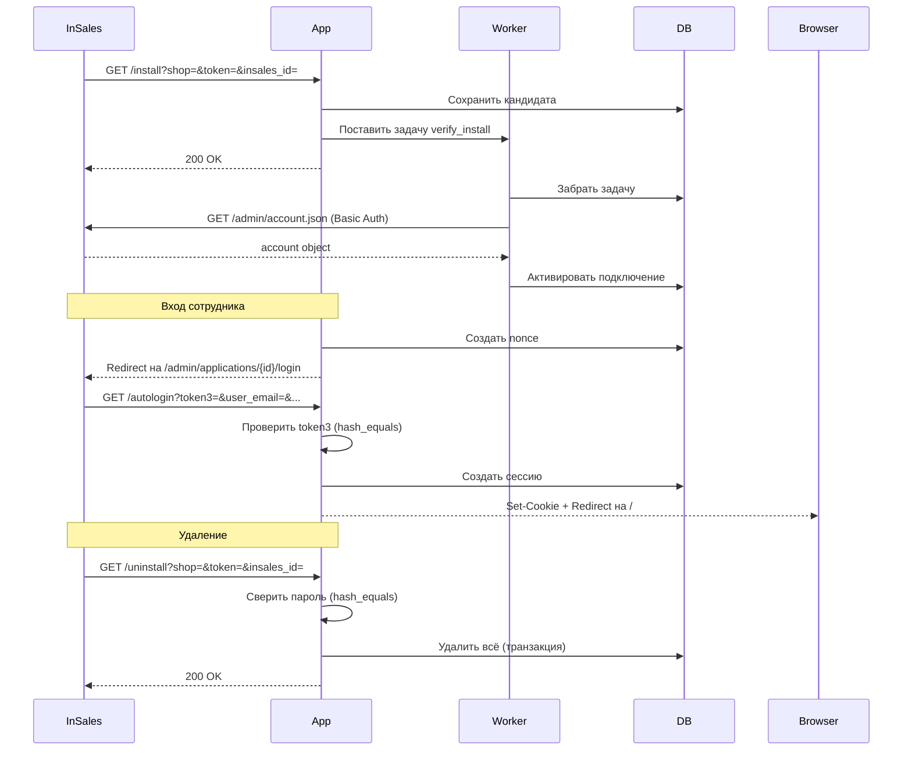

# InSales Partner App (PHP)

Заготовка устанавливаемого партнёрского приложения InSales на PHP 8.4+.

**Архитектура:** Slim 4 + Guzzle + PDO/SQLite + PHP-DI.
**Протокол:** классический install / autologin / uninstall.

> **Статус:** заготовка для разработки. Не является production-ready решением без
> аудита безопасности, замены SQLite на промышленную БД и настройки HTTPS.

---

## Быстрый старт

### Требования

- PHP 8.4+
- Расширения: `ext-pdo`, `ext-pdo_sqlite`, `ext-sodium`, `ext-mbstring`, `ext-pcntl`, `ext-sockets`, `ext-curl`
- Composer 2
- Git

### Установка

```bash
git clone <url-репозитория> insales_app_php
cd insales_app_php
cp .env.example .env
```

Отредактируйте `.env`:

| Переменная | Описание |
|---|---|
| `INSALES_APP_ID` | Идентификатор приложения из кабинета InSales |
| `INSALES_APP_SECRET` | Секрет приложения из кабинета InSales |
| `APP_BASE_URL` | Публичный URL приложения (например, `https://myapp.example`) |
| `ALLOWED_SHOPS` | Список разрешённых доменов магазинов через запятую |
| `APP_ENCRYPTION_KEY` | 64-символьный hex-ключ (32 байта). **Сгенерируйте:** `php -r 'echo bin2hex(sodium_crypto_secretbox_keygen());'` |
| `APP_DB_PATH` | Путь к SQLite-файлу (по умолчанию `runtime/app.sqlite3`) |

Установите зависимости:

```bash
composer install
```

Запустите миграции и приложение:

```bash
# Миграции применяются автоматически при первом запуске.
# Для ручного запуска worker:
php bin/worker.php &

# Запуск встроенного сервера:
php -S 127.0.0.1:8765 -t public public/index.php
```

### Проверка здоровья

```bash
curl http://127.0.0.1:8765/health
# → ok
```

---

## Настройка в кабинете InSales

1. Зайдите в [партнёрский кабинет InSales](https://partners.insales.ru) → **Приложения** → **Новое приложение**.
2. Заполните:

   | Поле | Значение |
   |---|---|
   | Название | Ваше приложение |
   | URL установки | `https://myapp.example/install` |
   | URL входа | `https://myapp.example/login` |
   | URL деинсталляции | `https://myapp.example/uninstall` |
   | Права | Запросите только нужные (для демо: `read account`) |

3. Скопируйте **идентификатор** и **секрет** в `.env`.

После установки приложения на магазин, InSales вызовет `/install`, приложение
сохранит кандидата, ответит 200 и асинхронно проверит доступ к API магазина.
При успешной проверке подключение активируется.

---

## Жизненный цикл приложения



### Установка

InSales вызывает `GET /install?shop=SHOP&token=TOKEN&insales_id=ID`.

Пароль магазина: `MD5(token + secret)` (нижний регистр, hex, без разделителя).

Приложение должно ответить **200 за 10 секунд**. Долгие операции выносятся в
фоновый worker. Действующее подключение не заменяется, пока новое не проверено.

### Вход

1. `GET /login?shop=SHOP&insales_id=ID` — создаёт одноразовый nonce (TTL 5 мин),
   связанный с браузером и магазином. Перенаправляет браузер в InSales.
2. InSales вызывает `GET /autologin?token3=...&user_email=...&...`.
   Проверяется подпись `token3` через `hash_equals`.
   После успеха создаётся серверная сессия (HttpOnly cookie).

Формула: `token3 = MD5(nonce + user_email + user_name + user_id + email_confirmed + password)`

Поля конкатенируются без разделителя, UTF-8. `email_confirmed` — строка `"true"` или `"false"`.

### Удаление

InSales вызывает `GET /uninstall?shop=SHOP&token=PASSWORD&insales_id=ID`.
Параметр `token` — **пароль магазина** (не install token, не secret).
Сравнение через `hash_equals`. Атомарное удаление в транзакции.

---

## Разработка

### Команды

```bash
composer test              # Все тесты (unit + integration)
composer test:unit         # Только unit-тесты
composer test:integration  # Только integration-тесты
composer analyse           # PHPStan (максимальный уровень)
composer lint              # PHPCS (PSR-12)
composer lint:fix          # Автоисправление стиля
composer audit             # Composer audit зависимостей
composer check             # Линтинг + анализ + тесты (полная проверка)
```

### Структура проекта

```
public/                     # HTTP entry point (index.php)
src/
  InSales/                  # Протокольный слой (не зависит от фреймворка)
    Protocol.php            #   MD5-формулы (installPassword, token3)
    ApiClient.php           #   HTTP-клиент к API InSales
    ApiException.php        #   Ошибки API
    ShopValidator.php       #   Валидация доменов магазинов
    NullLogger.php          #   Заглушка логгера
  Application/              # Сценарии жизненного цикла
    InstallationService.php #   Установка + верификация
    LoginService.php        #   Вход / autologin / сессии
    UninstallService.php    #   Удаление
  Http/                     # Slim-слой
    Controllers/            #   Контроллеры (Install, Login, Uninstall, Dashboard)
    Middleware/              #   SessionMiddleware
  Infrastructure/           # Инфраструктура
    Database.php            #   PDO/SQLite с миграциями
    Encryption.php          #   Sodium (XSalsa20-Poly1305)
    JobQueue.php            #   Очередь заданий (SQLite)
    Config.php              #   Загрузка конфигурации
migrations/                 # SQL-миграции
bin/
  worker.php                # Фоновый worker для задач
tests/
  Unit/                     # Unit-тесты
  Integration/              # Интеграционные тесты (с HTTP-симулятором)
  Simulator/                # Симулятор платформы InSales
  Fixtures/                 # Тестовые векторы
  bootstrap.php             # Загрузчик тестов
.github/workflows/          # CI + Security audit
```

### Добавление бизнес-логики

1. **Новый API-метод:** добавьте метод в `InSales\ApiClient`, напишите тест.
2. **Новый фоновый job:** создайте обработчик в `Application/`, зарегистрируйте
   в `bin/worker.php` (секция `match`).
3. **Новый HTTP-маршрут:** создайте контроллер в `Http/Controllers/`,
   зарегистрируйте в `src/Infrastructure/SlimAppFactory.php`.
4. **Вебхуки:** добавьте контроллер-обработчик, зарегистрируйте маршрут.
   Для аутентификации вебхука используйте сохранённый секрет подписки (не
   придумывайте встроенную подпись InSales — её нет в контракте).
   InSales не отправляет HMAC-заголовки как в Shopify.

---

## Тестирование

Обычный запуск `composer test` не требует внешних ресурсов. Интеграционные тесты
используют встроенный симулятор платформы InSales (локальный HTTP-сервер).

### Симулятор

`Tests\Simulator\PlatformSimulator` реализует конечный набор endpoints:
- `GET /admin/account.json` — проверка Basic Auth
- `GET /admin/applications/{id}/login` — редирект с подписями
- Неизвестные маршруты → 404

Симулятор не является полной реализацией платформы InSales и не доказывает
совместимость с реальным магазином.

### Проверка на тестовом магазине

Для дополнительной проверки на реальном InSales:

1. Разверните приложение на HTTPS-сервере (например, ngrok).
2. Создайте тестовый магазин в партнёрском кабинете.
3. Установите приложение, выполните вход, проверьте API.
4. Убедитесь, что удаление работает корректно.

**Внимание:** не используйте рабочие магазины для первичного тестирования.

---

## Различия development / production

| Аспект | Development | Production |
|---|---|---|
| HTTP | Разрешён для loopback | Только HTTPS |
| SQLite | Подходит для разработки | Заменить на PostgreSQL/MySQL |
| Worker | Один процесс, in-process | Supervisor + несколько workers |
| Очередь | SQLite-очередь | RabbitMQ / Redis / SQS |
| Логирование | NullLogger | PSR-3 совместимый логгер (Monolog) |
| Хранилище | SQLite-файл | Промышленная БД с бэкапами |
| Сессии | In-memory / SQLite | Redis / БД |

---

## Ограничения заготовки

- SQLite не подходит для production (конкурентный доступ).
- Очередь на SQLite теряет производительность при высокой нагрузке.
- Отсутствует полноценная обработка вебхуков (документированная точка расширения).
- Нет OAuth/OIDC входа покупателей.
- Нет полной синхронизации товаров/заказов.
- Нет rate limiter на входящие запросы (защита от DoS).
- Ключ шифрования в `.env` — для production использовать secrets manager.
- Встроенный PHP-сервер — только для разработки.

---

## Лицензия

MIT